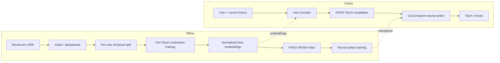
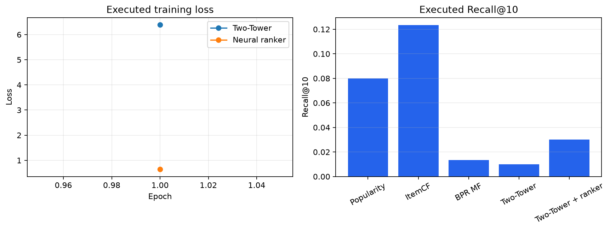

# Intelligent Recommendation Engine

A production-style personalized recommendation system built for a normal developer laptop. It learns a shared user-movie embedding space with PyTorch, retrieves candidates with FAISS, and re-ranks them with a neural cross-feature model. The project is designed to be inspectable: it includes leakage-safe evaluation, runnable baselines, an API, a Streamlit dashboard, Docker, CI, and generated—not hand-authored—metrics.

> **Data and results policy:** the default command downloads public MovieLens 100K and writes the actual evaluation report to `docs/benchmark_results.md`. Model artifacts and raw data are ignored by Git. This repository contains no invented benchmark values.

## Architecture



## Why this design

Retrieving directly from a full catalog is inexpensive for MovieLens but becomes costly as the catalog grows. The two-tower model separately encodes a user ID plus pooled interaction history and an item ID plus MovieLens genre vector. The contrastive, in-batch-negative objective makes their normalized dot product a retrieval score. FAISS HNSW returns a short candidate list, and the ranking MLP consumes `[user, item, user × item, retrieval score]` to make the final ordering.

The system handles sparse histories because the user encoder can pool even one event. A new user falls back to the learned default user embedding; in production, that behavior should be replaced or blended with a popularity policy and explicit session/context features.

## Data, cleaning, and evaluation

The default data source is [MovieLens 100K](https://grouplens.org/datasets/movielens/100k/), a public research dataset. The ingestion script downloads the original archive on first use and does the following:

- drops incomplete records, retains ratings at or above 4, and resolves duplicate user-movie ratings by retaining the latest timestamp;
- excludes users with fewer than four remaining positive events;
- holds out the final event per user for test and the penultimate event for validation;
- builds validation histories from training events only and test histories from training plus validation events;
- preserves item metadata as a compact genre feature vector.

All reported ranking metrics use a full-catalog leave-one-out protocol: the held-out target competes against every unseen catalog movie. The pipeline records Recall@5/10, NDCG@5/10, Hit Rate@10, catalog coverage, FAISS-vs-exact latency, and full-catalog reranking latency. It compares Popularity, item-item collaborative filtering, BPR matrix factorization, Two-Tower retrieval, and Two-Tower + neural ranker.

The checked-in laptop profile caps neural retrieval/ranking training at 5,000 temporal samples, BPR training at 3,000 interactions, and reporting at a deterministic 300-user temporal holdout subset. Every selected user is still scored against the full MovieLens catalog. These caps are explicit in `configs/training.yaml` and recorded in each artifact report; raise them for a longer production-style experiment.

After running training, see [the generated results](docs/benchmark_results.md). The JSON source of truth is `artifacts/report.json` and includes timing samples and loss curves.



## Tech stack

Python 3.12 · PyTorch · FAISS (`IndexHNSWFlat`) · NumPy/Pandas · FastAPI + Pydantic · Streamlit · pytest · GitHub Actions · Docker Compose. MLflow is an optional local-only experiment tracker (`requirements-mlflow.txt`); no paid or cloud service is required.

## Quick start

```bash
python -m venv .venv
# Windows PowerShell:
.\.venv\Scripts\Activate.ps1
pip install -r requirements.txt

# Downloads MovieLens 100K, trains, evaluates, and saves ignored artifacts.
python -m src.training.pipeline

# Tests include data/retrieval units and a trained synthetic API integration test.
pytest
```

For a CI-safe, no-download demonstration dataset, run `python -m src.training.pipeline --synthetic --epochs 1`. That mode is solely a deterministic test fixture; use the default command for the public-dataset portfolio demo.

### Launch the API

```bash
uvicorn api.main:app --reload
```

Swagger UI is available at `http://127.0.0.1:8000/docs`. Artifacts are cached per process. Override their location with `ARTIFACT_DIR`; copy `.env.example` if needed.

| Endpoint | Purpose |
|---|---|
| `GET /health` | Artifact-load status and retrieval backend |
| `GET /recommend/{user_id}?k=10` | Stored-history personalized recommendations |
| `POST /recommend` | Session-aware recommendation with optional history |
| `GET /similar-items/{item_id}?k=10` | Item-vector nearest neighbors |
| `GET /model-info` | Model, dataset, generated metric, and latency metadata |

```bash
curl "http://127.0.0.1:8000/recommend/1?k=5"
curl -X POST http://127.0.0.1:8000/recommend -H "content-type: application/json" \
  -d '{"user_id":"1","k":5,"history_item_ids":["50","258"]}'
```

### Launch the dashboard

```bash
streamlit run app/streamlit_app.py
```

The dashboard obtains results from the same local artifact cache as the API. It supports user selection, Top-K scoring, a retrieval-versus-ranker chart, similar-movie discovery, and loaded-model metadata—without hardcoded recommendations.

### Docker

```bash
# Trainer downloads data and creates bind-mounted artifacts first.
docker compose run --rm trainer
docker compose up api dashboard
```

The API is at port 8000 and the Streamlit interface at port 8501. `docker compose up` also works from a clean checkout: Compose waits for the training service to complete before starting the serving services.

## Repository guide

```text
api/                       FastAPI routes and cached artifact service
app/                       Streamlit dashboard
configs/                   checked-in reproducibility defaults
src/data/                  MovieLens ingest, cleaning, temporal split
src/models/                two-tower, ranker, and baselines
src/retrieval/             FAISS HNSW / exact comparison
src/evaluation/            full-catalog ranking metrics
src/training/              training orchestration and optional MLflow logger
tests/                     unit and API integration coverage
docs/                      generated metrics and reference assessment
```

## Reproducibility notes and limitations

- The fixed seed controls Python, NumPy, and PyTorch; a hardware/library-version change can still create small floating-point differences.
- MovieLens 100K has ratings rather than impressions/clicks, so ratings of 4+ are treated as implicit positives. Production work should use true exposure data and counterfactual-aware evaluation.
- HNSW is an approximate index. The report measures its observed latency beside exact NumPy inner-product search; it does not assume an improvement on this small catalog.
- The ranker trains against sampled negatives. A larger system should use hard negatives from retrieval, feature stores, monitoring, model/version registries, and online A/B testing.
- Model binaries, input data, and tracking runs are purposefully untracked. Recreate them with the documented commands.

## Reference and license

The independent design was informed by the two-stage architecture in [abdullahhrashid/industrial-recommender-system](https://github.com/abdullahhrashid/industrial-recommender-system), which is MIT-licensed. Its technical assessment and attribution are in [docs/reference_assessment.md](docs/reference_assessment.md). No source code, data, checkpoint, or reported metric was copied. This implementation is also released under the [MIT License](LICENSE).
